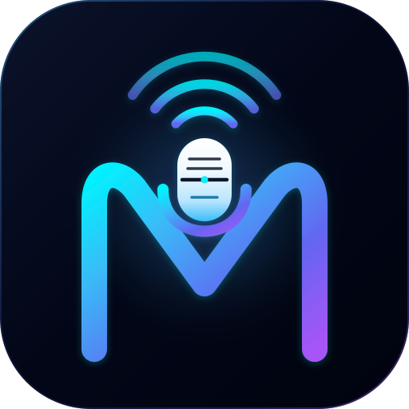

<div align="center">



# Crew Mic — Mach Dein Smartphone zum Kabellosen Mikrofon für Mac und Windows

**Nutze mehrere Android-Geräte und iPhones als WLAN-Mikrofone mit geringer Latenz. Mische sie am Computer und schicke das Ergebnis direkt in Zoom, OBS, Discord, Google Meet oder Teams.**

[](https://crewmic.codelumix.com/?utm_source=github&utm_medium=readme&utm_campaign=hero_de)


[English](README.md) · [Tiếng Việt](README.vi.md) · [Español](README.es.md) · [Português](README.pt-BR.md) · [Français](README.fr.md) · **Deutsch** · [Русский](README.ru.md) · [简体中文](README.zh-CN.md) · [日本語](README.ja.md) · [한국어](README.ko.md) · [Bahasa Indonesia](README.id.md) · [ไทย](README.th.md)

</div>

---

## Warum Crew Mic?

Einen Podcast mit drei Gästen aufnehmen, mit Co-Host streamen oder aus einem lauten Raum an einem Hybrid-Meeting teilnehmen: Meist braucht man dafür Funkmikrofon-Sets für mehrere hundert Euro.

**Dabei hast du die Mikrofone längst: deine Smartphones.**

Crew Mic verbindet **mehrere Smartphones** über dein lokales WLAN mit einem Computer. Jedes Handy wird zu einem eigenen Mikrofonkanal mit **KI-Rauschunterdrückung**, **automatischer Synchronisation zwischen den Mikros** und **Übersteuerungsschutz**. Der fertige Mix erscheint als **virtuelles Mikrofon**, das jede App auswählen kann.

> 🎙️ Keine Kabel. Keine Empfänger. Keine zusätzliche Hardware. App installieren, auf den Handys öffnen, losreden.

---

## ✨ Die wichtigsten Funktionen

| | Funktion | Dein Vorteil |
|---|---|---|
| 📱 | **Mehrere Handys gleichzeitig** | Verbinde mehrere Android-Geräte und iPhones auf einmal. Jedes bekommt einen eigenen Kanalzug. |
| ⚡ | **WLAN-Audio mit geringer Latenz** | Unkomprimiertes 48-kHz-Audio per UDP in 10-ms-Frames. Typische Gesamtlatenz: **40–100 ms**. |
| 🔇 | **KI-Rauschunterdrückung in 4 Stufen** | Das neuronale Netz RNNoise (Aus / Leicht / Mittel / Stark mit Noise Gate) entfernt Lüfter, Klimaanlage und Straßenlärm. Stufenwechsel ohne Klicken. |
| 🎯 | **Synchronisation mehrerer Quellen** | Richtet jedes Handy am tatsächlichen Aufnahmezeitpunkt aus, mit ≤ 5 ms Abweichung (p95). Das verhindert den hohlen „Tunnelklang“, wenn zwei Mikros auseinanderlaufen. |
| 🛡️ | **Master-Limiter** | Look-Ahead-Limiter (≤ 1 ms, Ceiling −1 dBFS) verhindert Verzerrungen, wenn alle gleichzeitig lachen. |
| 🎛️ | **Mischpult am Desktop** | Gain, Mute, Zeitversatz (±100 ms) und VU-Meter mit 30 Hz pro Kanal, dazu ein Master-Bus. |
| 🎧 | **Kopfhörer-Monitoring** | Höre den Live-Mix über einen separaten Ausgang ab: AirPods, USB-DAC oder 3,5-mm-Klinke. |
| 🔌 | **Funktioniert mit jeder App** | Ausgabe auf ein virtuelles Mikrofon (BlackHole unter macOS, VB-CABLE unter Windows) für Zoom, OBS, Discord, Meet, Teams und DAWs. |
| 🔍 | **Automatische Erkennung** | Die Handys finden deinen Computer per mDNS/Bonjour. Du gibst jedes Gerät frei, bevor es beitritt. |
| 🔒 | **Bleibt in deinem Netzwerk** | Das Audio geht direkt vom Handy zum Computer im lokalen Netz. Nichts wird in die Cloud hochgeladen. |

---

## 🎬 Für wen ist Crew Mic?

- **Podcaster**: Nimm 2–4 Personen auf, jede mit ihrem Handy als Ansteckmikrofon, perfekt synchron.
- **Streamer & YouTuber**: Füge in OBS das Mikro eines Co-Hosts oder Gasts hinzu, ganz ohne Funkset.
- **Remote- & Hybrid-Teams**: Verteile Handys auf dem Besprechungstisch, damit in Zoom oder Teams alle klar zu hören sind.
- **Lehrkräfte & Vortragende**: Bewege dich frei im Raum, mit dem Handy als kabellosem Mikrofon in der Tasche.
- **Interviewer & Journalisten**: Führe Zweier-Interviews mit Echtzeit-Monitoring.
- **Kirchen, Events & kleine Säle**: Baue in kurzer Zeit ein Mehrmikrofon-Setup für Vorträge und Podien auf.

---

## 🚀 In 3 Schritten loslegen

1. **Lade Crew Mic** für deinen Computer (macOS / Windows) und deine Handys (Android / iOS) herunter:
   👉 **[crewmic.codelumix.com](https://crewmic.codelumix.com/?utm_source=github&utm_medium=readme&utm_campaign=steps_de)**
2. **Installiere einen virtuellen Mikrofon-Treiber** (nur einmal nötig):
   - macOS: [BlackHole 2ch](https://existential.audio/blackhole/) (`brew install --cask blackhole-2ch`)
   - Windows: [VB-CABLE](https://vb-audio.com/Cable/)
3. **Verbinden & sprechen**: Starte die Desktop-App, öffne Crew Mic auf jedem Handy im selben WLAN, gib die Geräte frei und wähle das virtuelle Mikrofon in Zoom, OBS oder Discord.

> 💡 **Tipp:** Für die geringste Latenz nutze 5-GHz-WLAN und stelle das virtuelle Gerät auf **48.000 Hz**.

---

## ⚙️ Latenzmodi

| Modus | Geschätzte Gesamtlatenz | Ideal für |
|---|---|---|
| **Niedrig** | 40–60 ms | Live-Interviews und Echtzeitgespräche bei starkem 5-GHz-WLAN |
| **Ausgewogen** *(Standard)* | 60–100 ms | Die meisten Nutzer im normalen Heim- oder Büro-WLAN |
| **Stabil** | 100–180 ms | Schwaches Signal, große Entfernung oder ausgelastete Netze |

---

## 🧠 So funktioniert es

```text
 📱 Handy 1 (Android) ─┐
 📱 Handy 2 (iPhone)  ─┼── WLAN · 48 kHz PCM · UDP ──►  💻 Crew Mic Desktop
 📱 Handy N (...)     ─┘                                 │
                                                         ├─ Adaptiver Jitter-Buffer
                                                         ├─ Taktdrift-Korrektur
                                                         ├─ KI-Rauschunterdrückung RNNoise
                                                         ├─ Quellensynchronisation
                                                         └─ Look-Ahead-Limiter
                                                                │
                                  ┌─────────────────────────────┴───────────────┐
                                  ▼                                             ▼
                   🎙️ Virtuelles Mikro (BlackHole / VB-CABLE)        🎧 Monitoring-Kopfhörer
                                  │
                                  ▼
                    Zoom · OBS · Discord · Meet · Teams
```

Die Desktop-Engine ist in **Rust** (Tauri v2) für Echtzeit-Audio geschrieben: lock-freies Mischen ohne Speicherallokation im Audio-Thread. Die Mobile-Apps nutzen native Audio-APIs (Android `AudioRecord`, iOS `AVAudioEngine`) für minimale Aufnahmelatenz.

---

## ❓ Häufige Fragen

<details>
<summary><b>Kann ich mein Handy als Mikrofon für PC oder Mac nutzen?</b></summary>

Ja. Installiere Crew Mic auf Handy und Computer, verbinde beide mit demselben WLAN, und dein Handy funktioniert in jeder Desktop-App als kabelloses Mikrofon.
</details>

<details>
<summary><b>Wie viele Handys kann ich gleichzeitig verbinden?</b></summary>

Crew Mic ist für mehrere gleichzeitige Mikrofone gebaut. Ein Podcast oder Podium nutzt meist 2–4 Handys, jedes mit eigenem Kanal für Gain, Mute und Rauschunterdrückung.
</details>

<details>
<summary><b>Funktioniert es mit Zoom, OBS, Discord und Google Meet?</b></summary>

Ja. Crew Mic gibt den Mix auf ein virtuelles Audiogerät aus (BlackHole oder VB-CABLE). Wähle es einfach als Mikrofon in der App aus.
</details>

<details>
<summary><b>Brauche ich eine Internetverbindung?</b></summary>

Nein. Das Audio läuft nur über dein lokales Netzwerk (WLAN); Handys und Computer müssen nur im selben Netz sein.
</details>

<details>
<summary><b>Kann ich Android und iPhone mischen?</b></summary>

Ja. Android- und iOS-Geräte treten derselben Sitzung bei und werden automatisch synchronisiert.
</details>

<details>
<summary><b>Warum klingt es mit zwei Mikros hohl?</b></summary>

Das ist ein Kammfilter-Effekt, verursacht durch zeitlich versetzte Mikrofone. Aktiviere die **Quellensynchronisation** in Crew Mic, um alle Kanäle auf wenige Millisekunden genau auszurichten.
</details>

---

## 📥 Download

<div align="center">

### Bereit, deine Handys in ein professionelles Mikrofon-Setup zu verwandeln?

[](https://crewmic.codelumix.com/?utm_source=github&utm_medium=readme&utm_campaign=footer_de)

⭐ **Wenn dir Crew Mic hilft, gib dem Repo einen Stern**, damit mehr Creator es finden.

</div>

---

## 💬 Feedback & Support

- 🐛 Melde Fehler oder wünsche dir Funktionen unter [Issues](../../issues)
- 🌐 Website: [crewmic.codelumix.com](https://crewmic.codelumix.com/?utm_source=github&utm_medium=readme&utm_campaign=support_de)
- 🏢 Entwickelt von [CodeLumix](https://codelumix.com/?utm_source=github&utm_medium=readme)

<sub>**Stichwörter:** Handy als Mikrofon, Smartphone als Mikrofon für PC, kabelloses Mikrofon App, WLAN-Mikrofon, iPhone als Mikrofon für Mac, Android als Mikrofon für Windows, Podcast-Mikrofon, OBS Funkmikrofon, Zoom Mikrofon, KI-Rauschunterdrückung, virtuelles Mikrofon.</sub>
